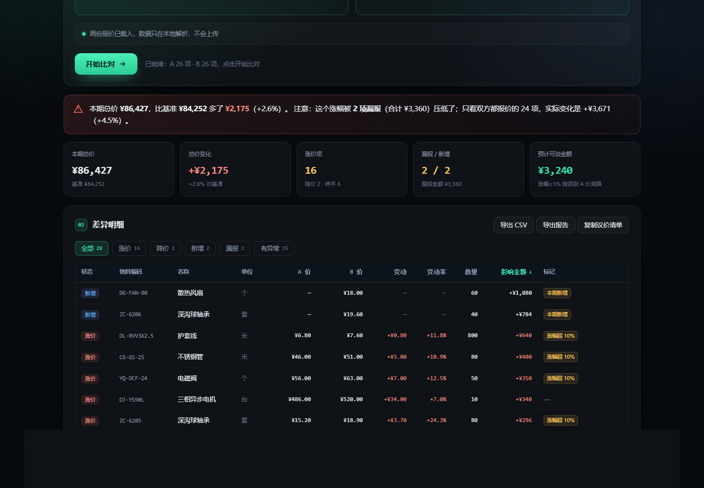
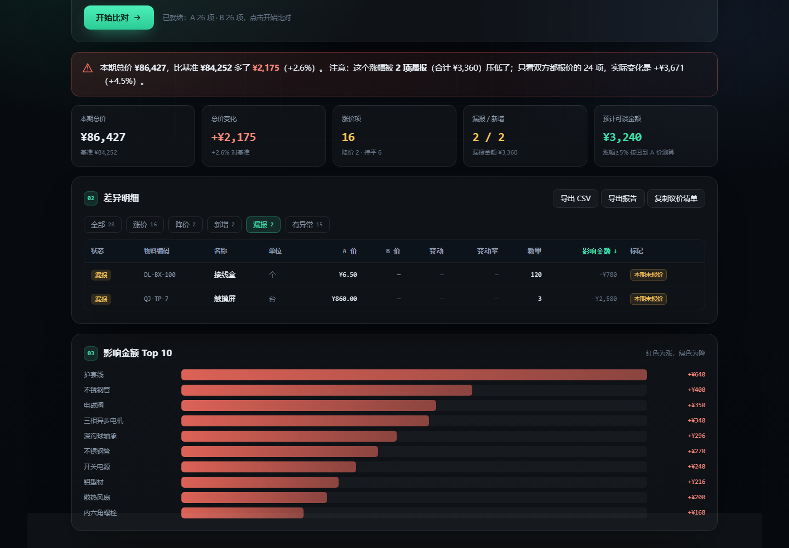
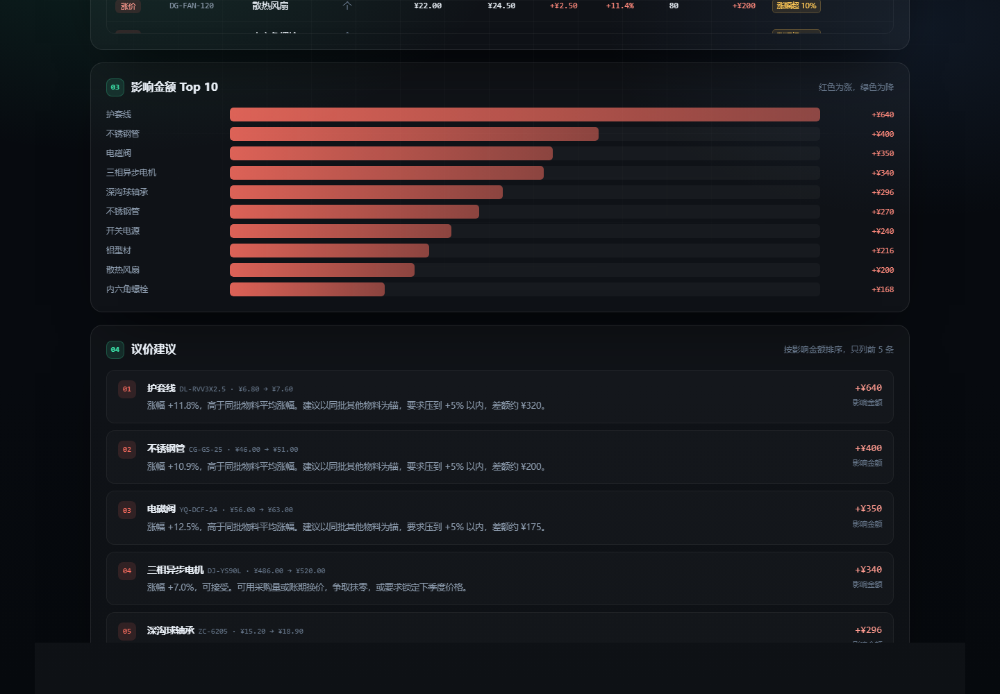

# 报价雷达 QuoteRadar

> 把两份供应商报价拖进来，8 秒看清涨了多少、漏了什么、先谈哪几项。

TRAE「好应用大赏赛」参赛作品 · 效率工具赛道。纯静态网页，无后端、无 API Key、数据不出浏览器。

在线体验：<https://yigenfeng0707-netizen.github.io/quote-radar/?demo=1>（打开即自动载入示例并完成比对）

## 效果预览

| 首屏 | 结果总览 |
| --- | --- |
|  |  |

| 筛选漏报 | 图表与议价建议 |
| --- | --- |
|  |  |

## 一句话价值主张

采购比价最费时间的不是算总价，而是从两张表里找出「该谈哪几项」。报价雷达把这件事压缩成一次点击：自动匹配物料、标出涨价/降价/漏报/新增、按影响金额排序，并直接生成可发出去的议价清单。

## 90 秒评审路径

1. 打开体验地址（或本地 `index.html`），页面自带两份示例报价，无需准备文件。
2. 点「一键载入示例数据」→ 点「开始比对」（也可直接访问 `?demo=1` 一步到位）。
3. 按顺序看四块：顶部结论 → 5 个 KPI → 差异明细（可筛选/排序）→ 议价建议（可复制）。
4. 想验证真实数据：任选一侧拖入自己的 CSV，列名含「物料编码 / 单价 / 数量」即可自动识别。

示例数据刻意埋了 6 类问题，方便评委判断引擎是否真的在工作：

| 埋点 | 物料 | 现象 |
| --- | --- | --- |
| 大幅涨价 | ZC-6205 | 15.20 → 18.90（+24.3%） |
| 单位偷换 | LX-6063-40 | 单价不变，单位「米」变「根」 |
| 金额算错 | DG-24V5A | 金额 4200 ≠ 72 × 60 |
| 交期翻倍 | CG-GS-50 | 14 天 → 28 天 |
| 漏报 | QJ-TP-7、DL-BX-100 | A 有 B 无，合计 ¥3,360 |
| 新增 | ZC-6206、DG-FAN-80 | B 有 A 无，可用于掩护整体涨价 |

示例的预期结果：基准 ¥84,252 / 本期 ¥86,427 / 变化 +¥2,175（+2.58%）/ 涨价 16 项 / 漏报 2 项 / 新增 2 项 / 预计可谈 ¥3,240。

## 计算口径

- 影响金额 =（B 价 − A 价）× 数量；数量优先取 B 表，缺失取 A 表，均缺失按 1 计。
- 总价变化按「B 表全部行 − A 表全部行」计算，因此会被漏报项拉低；页面同时给出「只看双方都报价项」的变化，避免误判。
- 预计可谈金额 = 涨幅 ≥ 5% 的涨价项影响金额合计，按回到 A 价测算，是理论上限。
- 异常规则：涨幅 ≥ 10% / ≥ 30%、单位不一致、交期延长 ≥ 7 天、金额 ≠ 单价 × 数量、编码重复。

## 隐私与边界

- 所有解析与计算在浏览器内完成，不上传、不存储、不发起任何网络请求。
- 支持 UTF-8 与 GBK（Excel 导出常见）编码，自动识别 `,` / Tab / `;` / `|` 分隔符。
- 当前只做「两份报价的横向比对」，不做供应商评分、历史趋势和审批流。

## 本地运行

任选一种，直接打开页面即可（无需安装依赖、无需构建）：

```bash
# 方式一：直接双击 index.html
# 方式二：起一个静态服务
python -m http.server 8123
# 访问 http://127.0.0.1:8123/
```

## 部署

纯静态站点，任何静态托管都能跑：

- GitHub Pages：把 `quote-radar` 目录推到仓库，Settings → Pages 选择分支与目录即可。
- Netlify / Vercel / Cloudflare Pages：直接拖入目录，无需构建命令，输出目录为根目录。

资源全部使用相对路径（`assets/...`），部署在子路径下也能正常加载。

## 目录结构

```
quote-radar/
├── index.html          # 页面骨架
├── assets/
│   ├── styles.css      # 设计系统与响应式
│   └── app.js          # CSV 解析、字段识别、比对引擎、渲染与导出
└── README.md
```

## TRAE 过程证据（提交前填写）

比赛要求提供用 TRAE 完成开发的留痕，以下为占位，提交时替换为真实信息：

| 项 | 内容 |
| --- | --- |
| Session ID | `<填写 TRAE Session ID>` |
| 关键对话截图 | `<需求拆解 / 比对引擎 / 结果页 / 修复记录 各 1 张>` |
| 迭代说明 | 第一版仅支持固定列名；第二版增加自动列识别与 GBK 回退；第三版补充异常规则与议价清单导出 |

## 免责声明

示例数据为虚构采购场景，仅用于演示；实际议价请以合同与供应商确认为准。
